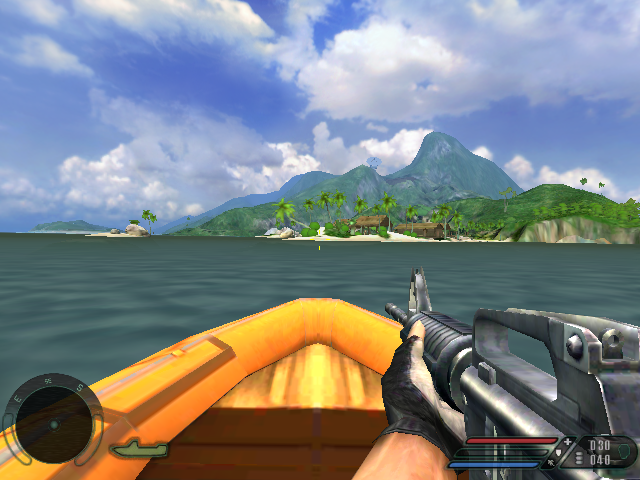
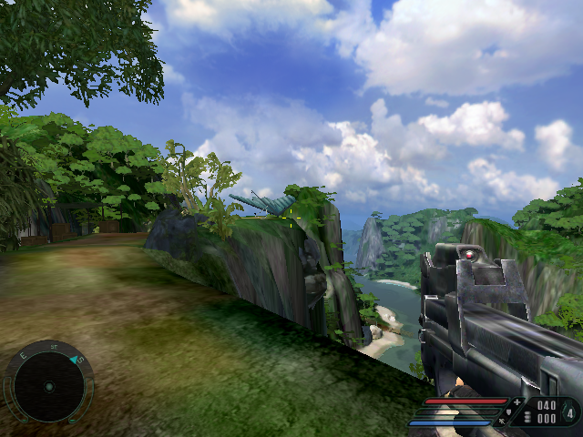
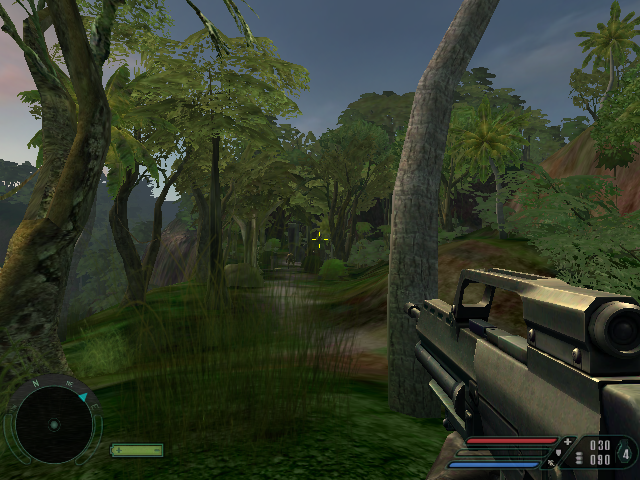
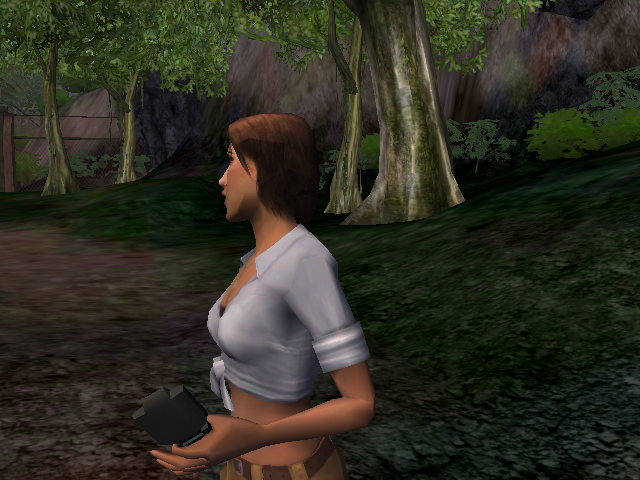

# RECry

Far Cry (2004) on its original CryEngine, built for Linux / OpenGL ES 3 handhelds
and packaged for [PortMaster](https://portmaster.games).

- The engine from the Far Cry 1 source SDK, ported to Linux, aarch64 and OpenGL ES 3
  (a native GLES3 renderer), with SDL2 for display, sound and input.
- The story cutscenes (Bink) play through a small bundled FFmpeg build.
- A launcher unpacks your GOG installer on the device and offers the port's settings.
- Any screen size, render resolution and aspect ratio (4:3, 16:10, 16:9).

**No game files are included.** You need your own copy of Far Cry from
[GOG.com](https://www.gog.com/en/game/far_cry).

## Screenshots

Captured on the Anbernic RG40XX-H (H700) at 640x480 with the launcher's Auto settings,
unedited:

| | |
|---|---|
|  |  |
| Fort | Pier |
|  |  |
| Catacombs | Swamp |

## Performance: Anbernic RG40XX-H (Allwinner H700)

Measured on an RG40XX-H (H700, 4x Cortex-A53 at 1.5 GHz, Mali-G31, 1 GB RAM, muOS),
640x480, launcher defaults (Auto). Each level ran 40 seconds of gameplay from its start:

| Level | FPS | | Level | FPS |
|---|---|---|---|---|
| Training | 30.0 | | Catacombs | 29.9 |
| Carrier | 30.0 | | River | 30.0 |
| Fort | 29.9 | | Swamp | 30.0 |
| Pier | 30.0 | | Regulator | 29.9 |
| Research | 30.0 | | Factory | 30.0 |
| Treehouse | 30.0 | | Archive | 30.0 |
| Bunker | 30.0 | | Dam | 30.0 |
| Rebellion | 30.0 | | Boat | 30.0 |
| Steam | 30.0 | | Volcano | 30.0 |
| Cooler | 30.0 | | Control | 30.0 |

The game is capped at 30 FPS (launcher: Frame limit). A typical frame needs 7-23 ms of the
33 ms budget. On slow handhelds "Auto" turns on three trade-offs:

- **Physics:** idle objects sleep sooner, fewer solver steps.
- **Effects:** fewer particles and decals, no water reflections.
- **View distance:** shorter draw distance for props, not for characters.

Each can be switched off in the launcher. Without them the H700 runs Fort and Catacombs
at about 26-27 FPS.

The first visit to each level is slower for a minute: textures are converted for the GPU
once and cached in `ports/recry/cache/`.

## Installation

1. Download `recry.zip` from the [releases](../../releases) and unzip it: copy `RECry.sh`
   into your Ports folder (for example `Roms/PORTS`) and the `recry` folder into `ports`.
2. Copy both files of the GOG installer into `ports/recry/installer/`:
   - `setup_far_cry_1.40_hotfix_(29940).exe`
   - `setup_far_cry_1.40_hotfix_(29940)-1.bin`
3. Start **RECry**. The first start unpacks the game into `ports/recry/gamedata/` with
   PortMaster's innoextract. It takes about 35 minutes on an H700 and needs 4 GB of free space.
   Afterwards the launcher offers to delete the installer.

Instead of the installer you can copy an installed Far Cry (`FCData`, `Levels`, `Shaders`,
`Languages` and `game.cfg`) into `ports/recry/gamedata/`.

Everything the port writes stays in `ports/recry/`:

- `conf/`: settings, engine config and saves
- `cache/`: converted textures (made from your game files, do not share them)
- `log.txt` and `logs/`: logs

### Requirements

- An aarch64 handheld with OpenGL ES 3 and PortMaster
- Firmware with glibc 2.30 or newer
- About 4 GB free on the SD card

### Controls

Two presets, chosen in the launcher (Controls). Both go through PortMaster's gptokeyb2, so
they work with each handheld's own controls. Classic: gptokeyb2 presents a virtual Xbox pad
and the game maps it. Modern shooter: `recry/controls/modern.gptk` maps the buttons to the
game's keyboard/mouse bindings (edit it, or add your own `<name>.gptk` there).

**Classic**

| Button | Action | | Button | Action |
|---|---|---|---|---|
| Left stick | Move | | LB / RB | Lean left / right |
| Right stick | Look | | L3 | Sprint |
| RT / LT | Fire / aim (zoom) | | R3 | Crouch / prone |
| A | Jump | | D-pad up | Fire mode |
| B | Use, enter vehicles | | D-pad down | Throw grenade |
| X | Reload | | Select | Objectives / score |
| Y / D-pad left | Next / previous weapon | | Start | Pause menu |

**Modern shooter** (based on the Steam Input layout "Far Cry 1 custom layout to match modern
shooters"; gptokeyb2 has no tap-vs-hold, so its hold actions are on an LB layer):

| Button | Action | | Button | Action |
|---|---|---|---|---|
| Left stick | Move | | RB | Throw grenade |
| Right stick | Look | | L3 / R3 | Sprint / flashlight |
| RT / LT | Fire / aim | | D-pad up / down | Binoculars / grenade type |
| A | Jump | | D-pad left / right | Lean left / right |
| B | Crouch (hold) | | Select | Pause menu |
| X | Reload | | Start | Objectives / score |
| Y | Next weapon | | LB + B / X / Y | Prone / use / fire mode |
| | | | LB + right stick | Lean |

## Launcher settings

| Setting | |
|---|---|
| Resolution | Game resolution. Auto = the screen up to 480 lines, else 480 lines at the screen's shape |
| Picture | Keep aspect (bars when shapes differ) or stretch |
| Physics / Effects / View distance | Auto chooses by device: simplified on slow handhelds, stock Far Cry on fast ones |
| Menu text size | Bigger menu text for small screens |
| Frame limit | 30, 60 or uncapped |
| FPS counter | Off, On (a small counter) or Built-in (the engine's own statistics) |
| CPU | Performance governor while playing (restored on exit) |
| Look speed / Pointer speed | Right stick turning speed and the menu pointer speed, 5-200 % (30 % = default) |
| Controls | Classic or Modern shooter (see Controls) |

In the menus either stick moves the pointer and A clicks.

## Building

No game files are needed to build. On Debian 12 / Ubuntu 22.04+ (x86-64):

```sh
sudo dpkg --add-architecture arm64 && sudo apt-get update
sudo apt-get install -y curl make cmake bzip2 xz-utils zip libsdl2-dev:arm64 libsdl2-ttf-dev:arm64
tools/build.sh            # -> dist/recry.zip
```

`tools/build.sh` downloads the Bootlin aarch64 toolchain (GCC 8.4, glibc 2.30) and FFmpeg 6.1.2,
then builds FFmpeg, the game, the launcher and the package. See [BUILDING.md](BUILDING.md)
for the full instructions, each step by hand and the project layout. Every push is built by
GitHub Actions; tags `v*` publish `recry.zip` as a release.

## Credits and licenses

Thanks to Crytek for Far Cry and for the engine source, and to Ubisoft. Thanks to the
PortMaster team for the runtime, gptokeyb and innoextract builds this port relies on.

The engine source and this port's changes to it are distributed under the CryEngine source
SDK license in [LICENSE](LICENSE): free of charge only, never commercially. Third-party
components are listed in [port/portmaster/licenses/THIRD_PARTY.md](port/portmaster/licenses/THIRD_PARTY.md).
Far Cry is a trademark of Crytek; this project is not affiliated with Crytek or Ubisoft.
