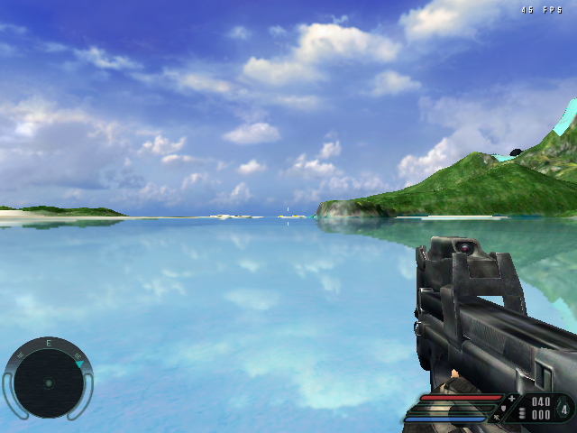
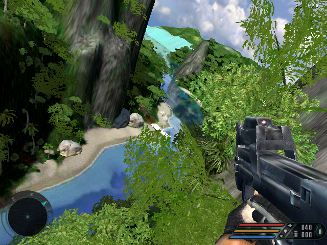
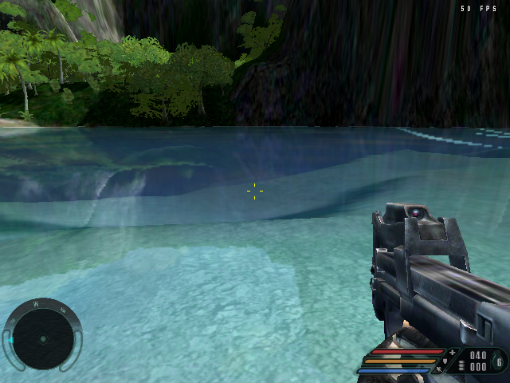
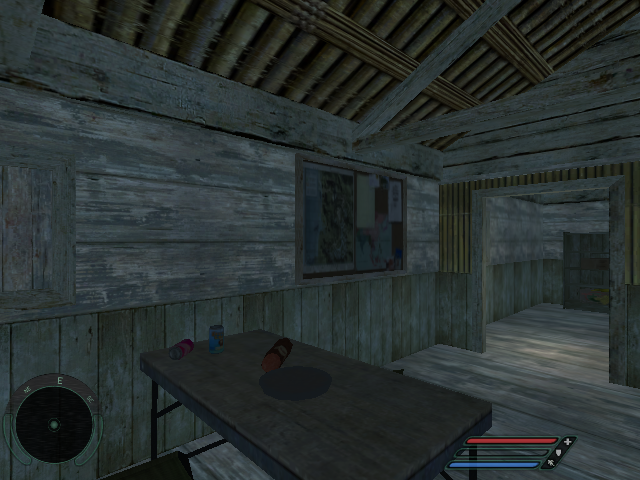

# RECry

Far Cry (2004) on its original CryEngine, built for Linux / OpenGL ES 3 handhelds
and packaged for [PortMaster](https://portmaster.games).

- The engine from the Far Cry 1 source SDK, ported to Linux, aarch64 and OpenGL ES 3
  (a native GLES3 renderer), with SDL2 for display, sound and input.
- The game's own Cg shader programs are translated to GLSL ES at runtime, so materials
  look as on a 2004 shader-model-2 PC: bump-mapped and specular surfaces, reflective
  water, underwater caustics.
- The story cutscenes (Bink) play through a small bundled FFmpeg build.
- A launcher unpacks your GOG installer on the device and offers the port's settings.
- Any screen size, render resolution and aspect ratio (4:3, 16:10, 16:9).

**No game files are included.** You need your own copy of Far Cry from
[GOG.com](https://www.gog.com/en/game/far_cry).

## Screenshots

Captured on the Anbernic RG40XX-H (H700) at 640x480 with the launcher's Auto settings,
unedited: the game's own shader programs (bump and specular materials, water reflections).

| | |
|---|---|
|  |  |
| Water reflections | Jungle, bump-mapped rock and waterfall |
|  |  |
| Underwater caustics | Training hut interior (PC capture, same renderer) |

## Performance

Measured with the frame limit off, 640x480, launcher defaults, water reflections on.
Median FPS, and the frame time that 95 % and 99 % of frames stay under (33 ms = 30 FPS):

| Test | Device | Median FPS | 95 % of frames | 99 % of frames |
|---|---|---|---|---|
| Pier time demo (jungle, beach, water) | Anbernic RG40XX-H (H700, Mali-G31) | 49.8 | 24.4 ms | 27.1 ms |
| Pier fight (scripted firefight with enemies) | Anbernic RG40XX-H (H700, Mali-G31) | 42.2 | 27.5 ms | 30.8 ms |
| Pier time demo | Anbernic RG DS (RK3568, Mali-G52, Panfrost) | 59.6 | 22.9 ms | 26.6 ms |

With the default frame limit (30 FPS) the game holds 30 almost everywhere; the dips that
remain come from long draw distances in open areas. The renderer is native OpenGL ES 3:
the game's own shader programs (bump and specular materials, water reflections)
translated to GLSL ES, with frames recorded by the game and drawn by a separate render
thread.

The handheld defaults trade a little detail for speed: idle physics objects sleep sooner,
fewer particles and decals, no cloth, and a shorter draw distance for props (not
characters). They are ordinary game settings and can be changed in the game's Options
menu.

The first visit to each level is slower for a minute: textures are converted for the GPU
once and cached in `ports/recry/cache/`, and the shader programs are built once and
cached as well.

## Installation

1. Download `recry.zip` from the [releases](../../releases) and unzip it: copy `RECry.sh`
   into your Ports folder (for example `Roms/PORTS`) and the `recry` folder into `ports`.
2. Copy both files of the GOG installer into `ports/recry/installer/`:
   - `setup_far_cry_1.40_hotfix_(29940).exe`
   - `setup_far_cry_1.40_hotfix_(29940)-1.bin`
3. Start **RECry**. The first start unpacks the game into `ports/recry/gamedata/` with
   PortMaster's innoextract. It takes about 35 minutes on an H700 and needs 4 GB of free space.
   Afterwards the launcher offers to delete the installer.

Instead of the installer you can copy an installed Far Cry (`FCData`, `Levels`, `Shaders`,
`Languages` and `game.cfg`) into `ports/recry/gamedata/`.

Everything the port writes stays in `ports/recry/`:

- `conf/`: settings, engine config and saves
- `cache/`: converted textures (made from your game files, do not share them)
- `log.txt` and `logs/`: logs

### Requirements

- An aarch64 handheld with OpenGL ES 3 and PortMaster
- Firmware with glibc 2.30 or newer
- About 4 GB free on the SD card

### Controls

Two gamepad layouts, chosen in the launcher (Controls):

- **Classic**: the game's own pad bindings (RT fire, LT aim, A jump, B use, X reload,
  Y next weapon, Start pause).
- **Modern shooter**: buttons mapped to the game's keyboard and mouse bindings in the
  style of current shooters (B crouch, D-pad down use, Select pause, a second layer on LB).

Every button of both layouts, the menu controls and how to make your own layout:
[docs/CONTROLS.md](docs/CONTROLS.md).

## Launcher settings

| Setting | |
|---|---|
| Resolution | Game resolution. Auto = the screen up to 480 lines, else 480 lines at the screen's shape |
| Picture | Keep aspect (bars when shapes differ) or stretch |
| Menu text size | Bigger menu text for small screens |
| Frame limit | 30, 60 or uncapped |
| FPS counter | Off, On (a small counter) or Built-in (the engine's own statistics) |
| CPU | Performance governor while playing (restored on exit) |
| Water | Reflections (default) or Simple (flat water, a little faster) |
| Restore default game settings | Undo changes made in the game's Options menu (press A twice); saves are kept |
| Look speed / Pointer speed | Right stick turning speed and the menu pointer speed, 5-200 % (30 % = default) |
| Controls | Classic or Modern shooter (see Controls) |

Graphics quality (particles, view distance, water, physics) is set in the game's own
Options menu. The port writes handheld defaults on first start and after updates;
your changes in the game menu are kept until you restore the defaults in the launcher.

In the menus either stick moves the pointer and A clicks. A, B or Start skips movies and
cutscenes (the ones Far Cry lets you skip).

## Building

No game files are needed to build. On Debian 12 / Ubuntu 22.04+ (x86-64):

```sh
sudo dpkg --add-architecture arm64 && sudo apt-get update
sudo apt-get install -y curl make cmake bzip2 xz-utils zip libsdl2-dev:arm64 libsdl2-ttf-dev:arm64
tools/build.sh            # -> dist/recry.zip
```

`tools/build.sh` downloads the Bootlin aarch64 toolchain (GCC 8.4, glibc 2.30) and FFmpeg 6.1.2,
then builds FFmpeg, the game, the launcher and the package. See [BUILDING.md](BUILDING.md)
for the full instructions, each step by hand and the project layout. Every push is built by
GitHub Actions; tags `v*` publish `recry.zip` as a release.

## Credits and licenses

Thanks to Crytek for Far Cry and for the engine source, and to Ubisoft. Thanks to the
PortMaster team for the runtime, gptokeyb and innoextract builds this port relies on.

The engine source and this port's changes to it are distributed under the CryEngine source
SDK license in [LICENSE](LICENSE): free of charge only, never commercially. Third-party
components are listed in [port/portmaster/licenses/THIRD_PARTY.md](port/portmaster/licenses/THIRD_PARTY.md).
Far Cry is a trademark of Crytek; this project is not affiliated with Crytek or Ubisoft.
